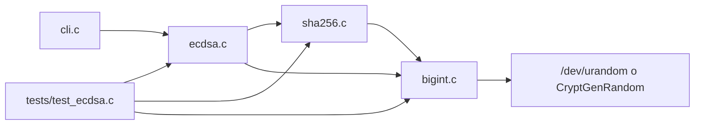

# CryptoLib — Funcionamiento y Proceso de Implementación de ECDSA (P-256)

**Universidad de Cuenca — Facultad de Ingeniería, Computación**
**Materia:** Seguridad Informática
**Autores:** Joselinne Banegas, Maria Lojano, Adrian Muñoz

Implementación completa en C del **Algoritmo de Firma Digital de Curva Elíptica (ECDSA)** conforme a:

| Norma | Uso en el proyecto |
|---|---|
| NIST FIPS PUB 186-5 | Generación de claves, firma y verificación (DSS) |
| NIST SP 800-186 §3.2.1.3 | Parámetros de dominio de la curva P-256 / secp256r1 |
| NIST FIPS PUB 180-4 / FIPS 198-1 | SHA-256 y HMAC-SHA256 |
| NIST FIPS 186-5 Apéndice B.2 | Inverso modular por algoritmo binario extendido |
| RFC 6979 | Generación determinista del nonce k (firma reproducible) |
| RFC 4231 | Vectores de prueba de HMAC-SHA256 |

---

## 1. Arquitectura del módulo

| Archivo | Responsabilidad |
|---|---|
| `include/libcrypt.h` | Infraestructura base: aritmética `BigInt`, SHA-256, HMAC y CSPRNG |
| `include/ecdsa.h` | Tipos `ECPoint`, `ECCurve`, `ECDSASignature` y prototipos ECDSA |
| `src/bigint.c` | Precisión arbitraria, aritmética modular, inversos (B.2 y Fermat), entropía |
| `src/sha256.c` | SHA-256, HMAC-SHA256 y conversión _digest_ → `BigInt` |
| `src/ecdsa.c` | Parámetros P-256, geometría, escalera de Montgomery y primitivas ECDSA |
| `src/cli.c` | Herramienta `keygen` / `sign` / `verify` |
| `tests/test_ecdsa.c` | Banco de pruebas (KAT, RFC 4231, CAVP, RFC 6979 y seguridad) |



La librería se empaqueta como `build/libcrypt.a`; los dos ejecutables (`test_ecdsa`, `ecdsa_cli`) se enlazan contra ella.

---

## 2. Fundamento matemático

### 2.1 Curva P-256 sobre F_p

Una curva elíptica en forma de Weierstrass:

```sh
E: y^2 ≡ x^3 + a·x + b (mod p)
```

Los parámetros cargados por `ec_init_p256()` son:

| Parámetro | Valor (hexadecimal) |
|---|---|
| p | `FFFFFFFF00000001000000000000000000000000FFFFFFFFFFFFFFFFFFFFFFFF` |
| a | `FFFFFFFF00000001000000000000000000000000FFFFFFFFFFFFFFFFFFFFFFFC` (=-3 mod p) |
| b | `5AC635D8AA3A93E7B3EBBD55769886BC651D06B0CC53B0F63BCE3C3E27D2604B` |
| Gx | `6B17D1F2E12C4247F8BCE6E563A440F277037D812DEB33A0F4A13945D898C296` |
| Gy | `4FE342E2FE1A7F9B8EE7EB4A7C0F9E162BCE33576B315ECECBB6406837BF51F5` |
| n | `FFFFFFFF00000000FFFFFFFFFFFFFFFFBCE6FAADA7179E84F3B9CAC2FC632551` |

El punto en el infinito (O) se modela con el campo `is_infinity` de `ECPoint`.

### 2.2 Aritmética de puntos (coordenadas afines)

__Duplicación__ (`ec_point_double`), para P ≠ O y y1 ≠ 0:

```ini
λ  = (3·x1^2 + a) / (2·y1)      (mod p)
x3 = λ^2 − 2·x1                 (mod p)
y3 = λ·(x1 − x3) − y1           (mod p)
```

__Adición__ (`ec_point_add`), para P ≠ ±Q:

```ini
λ  = (y2 − y1) / (x2 − x1)      (mod p)
x3 = λ^2 − x1 − x2              (mod p)
y3 = λ·(x1 − x3) − y1           (mod p)
```

Casos especiales tratados explícitamente:

- P = O ⇒ R = Q, y viceversa.
- x1 = x2 con y1 = y2 ⇒ duplicación.
- x1 = x2 con y1 ≠ y2 ⇒ R = O.
- Si 2·y1 ≡ 0 o x2 − x1 ≡ 0 (mod p), el inverso no existe y se devuelve O.

Las divisiones se implementan como multiplicación por el inverso modular (λ = num · den⁻¹ mod p), evitando divisiones enteras.

### 2.3 Multiplicación escalar: escalera de Montgomery

`ec_scalar_mul` __no__ usa Double-and-Add condicional: implementa una escalera de Montgomery sobre 256 iteraciones fijas.

```sh
R0 = O ;  R1 = P
for i = 255 downto 0:
    cs = bit_i(k)                     # solo como máscara, sin ramas
    cswap(R0, R1, cs)
    R1 = R0 + R1
    R0 = 2 · R0
    cswap(R0, R1, cs)
return R0
```

En cada iteración se ejecuta __exactamente__ una adición y una duplicación, sin importar el bit (0 o 1) ni la longitud del escalar; el recorrido es siempre de 256 bits. El intercambio condicional `ec_point_cswap` se hace con máscara `0xFFFFFFFF/0x00000000` sobre las 20 palabras de `BigInt` (no 8: `BIGINT_WORDS = 20`), sobre `len` y sobre `is_infinity`.

Esto elimina las ramas que dependían de los bits del escalar, aunque las operaciones de campo (`ec_point_add`, `ec_point_double`, `bigint_div`) siguen teniendo control de flujo dependiente de los datos, por lo que la propiedad _constant-time_ es parcial (ver sección 9).

---

## 3. Aritmética BigInt

`BigInt` representa enteros en **20 palabras de 32 bits (640 bits)**, con `limbs[0]` como extremidad menos significativa y `len` normalizado (sin palabras altas nulas).

| Operación | Estrategia |
|---|---|
| Suma / resta | Recorrido por palabras con acarreo / préstamo; la resta exige a ≥ b |
| Multiplicación | Producto escolar O(n²) con acumulador de 64 bits |
| División | División larga _shift-and-subtract_ bit a bit (resto siempre < b) |
| Módulo | Resto de la división |
| `add_mod` / `sub_mod` / `mul_mod` | Operación básica seguida de reducción |
| Inverso modular (campo) | Algoritmo binario extendido de NIST B.2, requisito módulo impar y mcd = 1 |
| Inverso modular (secreto) | Pequeño Teorema de Fermat con escalera: k^(m−2) mod m |
| Exponenciación modular | Escalera de Montgomery de 256 iteraciones (`bigint_exp_mod`) |
| Intercambio condicional | `bigint_cswap` con máscara, sin ramas |
| Aleatoriedad | Muestreo por rechazo uniforme en [min, max] |

**Detalles críticos:**

- `bigint_inv_mod` (B.2) se mantiene como ruta rápida para las operaciones de campo; exige módulo __impar__ y mcd(k, m) = 1, y devuelve error (0) con `res` en cero si no se cumple.
- `bigint_inv_mod_fermat` calcula k^(m−2) mod m con escalera de 256 iteraciones y __verifica__ que k · res ≡ 1 (mod m). Si m no es primo o k no es invertible devuelve 0, conservando la semántica de la versión binaria. Se usa para k⁻¹ en la firma, donde el inverso depende de un valor secreto.
- `bigint_exp_mod` ejecuta siempre 2 multiplicaciones modulares por iteración; la máscara de intercambio depende solo del exponente (público: n−2), no de la base.
- `bigint_from_hex` __rechaza__ cadenas vacías, caracteres no hexadecimales y valores de más de 160 dígitos (640 bits), en vez de truncar en silencio.
- `bigint_random_range` usa `cryptolib_random_bytes` (`/dev/urandom` en POSIX, `CryptGenRandom` en Windows) y descarta candidatos fuera de rango: distribución uniforme sin sesgo modular. Tras RFC 6979 solo se usa para generar claves.

---

## 4. Funciones de hash

### 4.1 SHA-256 (FIPS 180-4)

`sha256_init` / `sha256_update` / `sha256_final` implementan el estándar:

1. Relleno: `0x80`, ceros hasta que la longitud sea ≡ 56 (mod 64) y contador de bits en 8 bytes big-endian.
2. Bloques de 512 bits: expansión a 64 palabras y 64 rondas con Ch, Maj, Σ0 y Σ1.
3. Estado final de 8 palabras → 32 bytes big-endian.

`sha256_to_bigint` interpreta el digest como entero big-endian, que es el valor e usado por ECDSA.

### 4.2 HMAC-SHA256 (RFC 2104 / FIPS 198-1)

```c
void hmac_sha256(const uint8_t *key, size_t key_len,
                 const uint8_t *data, size_t data_len,
                 uint8_t out[32]);
```

Construcción: HMAC(K, m) = H((K' ⊕ opad) ‖ H((K' ⊕ ipad) ‖ m)), con bloque de 64 bytes. Si la clave supera 64 bytes se sustituye por H(K). La implementación:

- rellena la clave a 64 bytes y construye los pads `0x36` / `0x5c`;
- tolera *aliasing* (`out` puede ser la misma clave o los mismos datos) porque la clave se copia y los datos se consumen antes de escribir el resultado;
- borra pads y hash interno al finalizar.

Se valida con los vectores 1, 2 y 6 de **RFC 4231**, incluido el caso de clave de 131 bytes.

---

## 5. Algoritmos ECDSA

### 5.1 Generación de claves (`ecdsa_generate_keypair` / `ecdsa_keygen`)

1. d ∈R [1, n−1] con el CSPRNG del sistema.
2. Q = [d]G (con la escalera de Montgomery).
3. Validaciones: Q ≠ O y Q pertenece a la curva (incluyendo coordenadas canónicas).

### 5.2 Generación determinista de k (RFC 6979)

`ecdsa_sign` deriva k con HMAC-SHA256 en lugar del CSPRNG, según RFC 6979 §3.2:

- `int2octets(x)`: la clave privada como 32 bytes big-endian.
- `bits2octets(H(m))`: **reducción módulo n** del hash antes de serializar (el código original del tutorial omitía este paso y divergía del estándar cuando e ≥ n).
- `V = 0x01…`, `K = 0x00…`; luego `K = HMAC_K(V ‖ 0x00 ‖ d ‖ h)`, `V = HMAC_K(V)`, repitiendo con `0x01`.
- En cada iteración `V = HMAC_K(V)` y `k = bits2int(V)`; si 1 ≤ k ≤ n−1 y la firma es válida se devuelve. En caso contrario `K = HMAC_K(V ‖ 0x00)` y `V = HMAC_K(V)`.
- Ciclo acotado a 100 intentos y **borrado seguro** de V, K, buffers y candidato al salir.

Consecuencia: misma clave privada y mismo mensaje ⇒ misma (r, s), lo que permite reproducir vectores oficiales y elimina el riesgo de reutilización accidental de k.

### 5.3 Firma (`ecdsa_sign_with_k`)

Con e = SHA-256(m) interpretado como entero:

1. Validar d y k en [1, n−1].
2. (x1, y1) = [k]G; si es O, error.
3. r = x1 mod n; si r = 0, error (el llamador reintenta).
4. k⁻¹ mediante `bigint_inv_mod_fermat` (k es secreto).
5. s = k⁻¹ · (e + d·r) mod n; si s = 0, error.

### 5.4 Verificación (`ecdsa_verify`)

1. Rechazar si r ∉ [1, n−1] o s ∉ [1, n−1].
2. Rechazar si Q = O o si Q no es un punto canónico de la curva (x, y < p y y² ≡ x³ + a·x + b).
3. w = s⁻¹ mod n (algoritmo binario: s es público y la ruta rápida importa).
4. u1 = e·w mod n, u2 = r·w mod n (las multiplicaciones modulares ya reducen mód n).
5. X = [u1]G + [u2]Q; si X = O, rechazar.
6. Aceptar si y solo si Xx mod n = r.

```mermaid
sequenceDiagram
    participant E as Emisor
    participant R as Receptor
    E->>E: e = SHA-256(m), h = e mod n
    E->>E: K,V = HMAC-SHA256(RFC 6979)
    E->>E: k = bits2int(V); r = x([k]G) mod n
    E->>E: s = k^-1 (e + d·r) mod n
    E->>R: (m, r, s)
    R->>R: w = s^-1 mod n
    R->>R: X = [e·w]G + [r·w]Q
    R->>R: Xx mod n == r ?
    R-->>E: Válida / Rechazada
```

---

## 6. Proceso de implementación

### Fase 1 — Constantes y geometría

- Carga de parámetros P-256 desde cadenas hex oficiales (`ec_init_p256`).
- Implementación de suma, duplicación y multiplicación escalar.
- Control: G ∈ E(Fp), [1]G = G, [2]G igual al vector oficial, [n]G = O.

### Fase 2 — Aritmética de soporte

- `BigInt` completo y verificado con casos de acarreo, productos de 128 bits y división exacta.
- Inverso modular binario (NIST B.2) y CSPRNG multiplataforma.

### Fase 3 — Primitivas ECDSA

- `ecdsa_keygen`, `ecdsa_sign`, `ecdsa_sign_with_k`, `ecdsa_verify`.
- Control: reproducción bit a bit de un vector NIST CAVP (d, k, e → r, s).

### Fase 4 — Integración y CLI

- `Makefile` con objetivos `all`, `test`, `run`, `cli`, `clean`.
- CLI `keygen`, `sign`, `verify` con mensajes concatenados desde argumentos.
- Pruebas de seguridad: mensaje alterado, clave ajena y firma adulterada.

### Fase 5 — Endurecimiento y pruebas unitarias

1. __Validación estricta de hex__ (`bigint_from_hex`): sin truncamiento silencioso.
2. **Claves públicas canónicas**: rechazo de x ≥ p o y ≥ p.
3. __Corrección de `bigint_inv_mod`__: entradas no invertibles producían un inverso falso o un bucle infinito.
4. **SHA-256 KAT**, HMAC y pruebas unitarias de BigInt, más casos borde de la API.

### Fase 6 — Mitigaciones de canal lateral y firma determinista

1. `ec_point_cswap` + __escalera de Montgomery__ en `ec_scalar_mul` (256 iteraciones fijas).
2. `bigint_cswap`, `bigint_exp_mod` (escalera de 256 iteraciones) y `bigint_inv_mod_fermat`.
3. Inversión de Fermat aplicada a k⁻¹ en la firma (dato secreto).
4. `hmac_sha256` y `ecdsa_sign` con __RFC 6979__, con `bits2octets` y borrado seguro de buffers.
5. Vectores nuevos: RFC 4231 (HMAC) y RFC 6979 (firma determinista de P-256/SHA-256).

### Problemas encontrados y decisiones

| Problema | Decisión |
|---|---|
| División entera no existe en el grupo | Inverso modular + multiplicación |
| P = −Q o y1 = 0 | Devolver explícitamente O |
| Inverso inexistente en el algoritmo binario | Guardas de módulo par y de u/v nulos |
| Hex demasiado largo | Error de validación, nunca truncamiento |
| Clave no canónica | Chequeo de rango antes de la ecuación de curva |
| `cswap` del tutorial usaba 8 limbs | Corregido a `BIGINT_WORDS` (20 palabras) |
| RFC 6979 sin reducir h mod n | Añadido `bits2octets` (e mod n) |
| Fermat con módulo compuesto devolvía basura | Verificación k·res ≡ 1 y error si falla |
| Inversión de Fermat en todo el campo es ~1000× más lenta | Se usa solo para k⁻¹; el campo mantiene B.2 |

---

## 7. API pública relevante

| Función | Descripción |
|---|---|
| `ec_init_p256(ECCurve *c)` | Carga p, a, b, G, n |
| `ec_point_add` / `ec_point_double` | Operaciones de grupo |
| `ec_scalar_mul(c, k, P, R)` | R = [k]P mediante escalera de Montgomery |
| `ecdsa_generate_keypair(c, d, Q)` | d aleatorio (CSPRNG) y Q = [d]G |
| `ecdsa_keygen(c, d, Q)` | Deriva Q de un d dado y valida |
| `ecdsa_sign(c, d, e, sig)` | Firma determinista con k de RFC 6979 |
| `ecdsa_sign_with_k(c, d, e, k, sig)` | Firma con k explícito (CAVP) |
| `ecdsa_verify(c, Q, e, sig)` | Verificación completa |
| `ecdsa_point_is_on_curve(c, P)` | Pertenencia + canonicidad |
| `sha256_hash` / `sha256_to_bigint` | Digest y conversión a entero |
| `hmac_sha256` | HMAC-SHA256 (RFC 2104) |
| `bigint_inv_mod` / `bigint_inv_mod_fermat` | Inversos: binario B.2 / Fermat |
| `bigint_exp_mod` | Exponenciación modular en escalera |
| `bigint_random_range` | Muestreo uniforme para claves |

---

## 8. Uso de la CLI

```bash
make all                                   # librería + tests + CLI
./build/test_ecdsa                         # banco de pruebas
./build/ecdsa_cli keygen                   # par de claves (d, Qx, Qy)
./build/ecdsa_cli sign    <d> <mensaje>    # firma (r, s) determinista
./build/ecdsa_cli verify  <Qx> <Qy> <r> <s> <mensaje>
```

El entorno de compilación es Linux/WSL o MinGW/GCC; en Windows sin toolchain POSIX los binarios deben ejecutarse desde WSL (`wsl -d Ubuntu -- bash -lc "cd /mnt/c/... && make all && ./build/test_ecdsa"`).

---

## 9. Limitaciones y alcance didáctico

- __Constant-time parcial:__ la escalera y los intercambios eliminan ramas dependientes del escalar, pero `ec_point_add`/`ec_point_double` siguen ramificando por `is_infinity`, `y == 0` y `x1 == x2`, y `bigint_div` itera según el valor de los operandos. No sustituye a una librería endurecida (p. ej. con coordenadas proyectivas y reducción de Barrett).
- __Zeroización limitada:__ `ecdsa_sign` borra sus buffers (V, K, d y h serializados, candidato k), pero la clave privada copiada por valor en la pila y otros temporales no se limpian.
- **Solo P-256** y entradas hexadecimales: no hay serialización DER/ASN.1, PEM ni interoperabilidad directa con OpenSSL (no requerido por la especificación del proyecto).
- El truncamiento de e a bitlen(n) no se implementa porque SHA-256 y n tienen ambos 256 bits (caso equivalente según FIPS 186-5 §6.4).
- RFC 6979 fija la variante HMAC-SHA256; no se parametriza otra función hash.