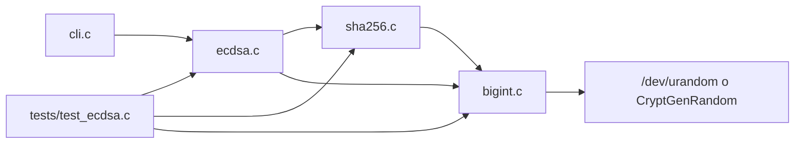
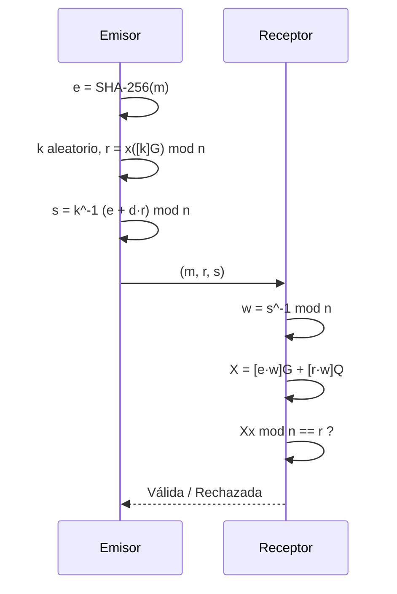

# CryptoLib — Funcionamiento y Proceso de Implementación de ECDSA (P-256)

**Universidad de Cuenca — Facultad de Ingeniería, Computación**
**Materia:** Seguridad Informática
**Autores:** Joseline Banegas, Maria Lojano, Adrian Muñoz

Implementación completa en C del **Algoritmo de Firma Digital de Curva Elíptica (ECDSA)** conforme a:

| Norma | Uso en el proyecto |
|---|---|
| NIST FIPS PUB 186-5 | Generación de claves, firma y verificación (DSS) |
| NIST SP 800-186 §3.2.1.3 | Parámetros de dominio de la curva P-256 / secp256r1 |
| NIST FIPS PUB 180-4 | Función resumen SHA-256 |
| NIST FIPS 186-5 Apéndice B.2 | Inverso modular por algoritmo binario extendido |

---

## 1. Arquitectura del módulo

| Archivo | Responsabilidad |
|---|---|
| `include/libcrypt.h` | Infraestructura base: aritmética `BigInt`, SHA-256 y CSPRNG |
| `include/ecdsa.h` | Tipos `ECPoint`, `ECCurve`, `ECDSASignature` y prototipos ECDSA |
| `src/bigint.c` | Precisión arbitraria, aritmética modular, inverso modular, entropía |
| `src/sha256.c` | SHA-256 y conversión _digest_ → `BigInt` |
| `src/ecdsa.c` | Parámetros P-256, geometría de la curva y primitivas ECDSA |
| `src/cli.c` | Herramienta `keygen` / `sign` / `verify` |
| `tests/test_ecdsa.c` | Banco de pruebas (KAT, CAVP y casos de seguridad) |



La librería se empaqueta como `build/libcrypt.a`; los dos ejecutables (`test_ecdsa`, `ecdsa_cli`) se enlazan contra ella.

---

## 2. Fundamento matemático

### 2.1 Curva P-256 sobre F_p

Una curva elíptica en forma de Weierstrass:

```sh
E: y^2 ≡ x^3 + a·x + b (mod p)
```

Los parámetros cargados por `ec_init_p256()` son:

| Parámetro | Valor (hexadecimal) |
|---|---|
| p | `FFFFFFFF00000001000000000000000000000000FFFFFFFFFFFFFFFFFFFFFFFF` |
| a | `FFFFFFFF00000001000000000000000000000000FFFFFFFFFFFFFFFFFFFFFFFC` (=-3 mod p) |
| b | `5AC635D8AA3A93E7B3EBBD55769886BC651D06B0CC53B0F63BCE3C3E27D2604B` |
| Gx | `6B17D1F2E12C4247F8BCE6E563A440F277037D812DEB33A0F4A13945D898C296` |
| Gy | `4FE342E2FE1A7F9B8EE7EB4A7C0F9E162BCE33576B315ECECBB6406837BF51F5` |
| n | `FFFFFFFF00000000FFFFFFFFFFFFFFFFBCE6FAADA7179E84F3B9CAC2FC632551` |

El punto en el infinito (O) se modela con el campo `is_infinity` de `ECPoint`.

### 2.2 Aritmética de puntos (coordenadas afines)

__Duplicación__ (`ec_point_double`), para P ≠ O y y1 ≠ 0:

```ini
λ  = (3·x1^2 + a) / (2·y1)      (mod p)
x3 = λ^2 − 2·x1                 (mod p)
y3 = λ·(x1 − x3) − y1           (mod p)
```

__Adición__ (`ec_point_add`), para P ≠ ±Q:

```ini
λ  = (y2 − y1) / (x2 − x1)      (mod p)
x3 = λ^2 − x1 − x2              (mod p)
y3 = λ·(x1 − x3) − y1           (mod p)
```

Casos especiales tratados explícitamente:

- P = O ⇒ R = Q, y viceversa.
- x1 = x2 con y1 = y2 ⇒ duplicación.
- x1 = x2 con y1 ≠ y2 ⇒ R = O.
- Si 2·y1 ≡ 0 o x2 − x1 ≡ 0 (mod p), el inverso no existe y se devuelve O.

Las divisiones se implementan como multiplicación por el inverso modular (λ = num · den⁻¹ mod p), evitando divisiones enteras.

### 2.3 Multiplicación escalar

`ec_scalar_mul` implementa __Double-and-Add__ de MSB a LSB:

```sh
acc = O
for i = bit_length(k)-1 downto 0:
    if acc != O: acc = 2·acc
    if bit_i(k) == 1: acc = acc + P
return acc
```

## Complejidad O(log k) duplicaciones/adiciones en lugar de O(k) sumas.

## 3. Aritmética BigInt

`BigInt` representa enteros en **20 palabras de 32 bits (640 bits)**, con `limbs[0]` como extremidad menos significativa y `len` normalizado (sin palabras altas nulas).

| Operación | Estrategia |
|---|---|
| Suma / resta | Recorrido por palabras con acarreo / préstamo; la resta exige a ≥ b |
| Multiplicación | Producto escolar O(n²) con acumulador de 64 bits |
| División | División larga _shift-and-subtract_ bit a bit (resto siempre < b) |
| Módulo | Resto de la división |
| `add_mod` / `sub_mod` / `mul_mod` | Operación básica seguida de reducción |
| Inverso modular | Algoritmo binario extendido de NIST B.2 |
| Aleatoriedad | Muestreo por rechazo uniforme en [min, max] |

**Detalles críticos:**

- El algoritmo binario de inversión exige módulo **impar** y mcd(k, m) = 1. Si m es par o si u/v llegan a cero, devuelve error (0) y deja el resultado en cero.
- `bigint_from_hex` __rechaza__ cadenas vacías, caracteres no hexadecimales y valores de más de 160 dígitos (640 bits), en vez de truncar en silencio.
- `bigint_random_range` usa `cryptolib_random_bytes` (`/dev/urandom` en POSIX, `CryptGenRandom` en Windows) y descarta candidatos fuera de rango: distribución uniforme sin sesgo modular.

---

## 4. SHA-256 (FIPS 180-4)

`sha256_init` / `sha256_update` / `sha256_final` implementan el estándar:

1. Relleno: `0x80`, ceros hasta que la longitud sea ≡ 56 (mod 64) y contador de bits en 8 bytes big-endian.
2. Bloques de 512 bits: expansión a 64 palabras y 64 rondas con Ch, Maj, Σ0 y Σ1.
3. Estado final de 8 palabras → 32 bytes big-endian.

`sha256_to_bigint` interpreta el digest como entero big-endian, que es el valor e usado por ECDSA.

---

## 5. Algoritmos ECDSA

### 5.1 Generación de claves (`ecdsa_generate_keypair` / `ecdsa_keygen`)

1. d ∈R [1, n−1] con el CSPRNG del sistema.
2. Q = [d]G.
3. Validaciones: Q ≠ O y Q pertenece a la curva (incluyendo coordenadas canónicas).

### 5.2 Firma (`ecdsa_sign`)

Con e = SHA-256(m) interpretado como entero:

1. k ∈R [1, n−1] (hasta 1000 reintentos si r o s resultan nulos).
2. (x1, y1) = [k]G; si es O, reintentar.
3. r = x1 mod n; si r = 0, reintentar.
4. s = k⁻¹ · (e + d·r) mod n; si s = 0, reintentar.
5. Firma: (r, s).

`ecdsa_sign_with_k` expone el mismo cálculo con k explícito, lo que permite reproducir vectores oficiales __NIST CAVP__ de forma determinista.

### 5.3 Verificación (`ecdsa_verify`)

1. Rechazar si r ∉ [1, n−1] o s ∉ [1, n−1].
2. Rechazar si Q = O o si Q no es un punto canónico de la curva (x, y < p y y² ≡ x³ + a·x + b).
3. w = s⁻¹ mod n.
4. u1 = e·w mod n, u2 = r·w mod n.
5. X = [u1]G + [u2]Q; si X = O, rechazar.
6. Aceptar si y solo si Xx mod n = r.



---

## 6. Proceso de implementación

### Fase 1 — Constantes y geometría

- Carga de parámetros P-256 desde cadenas hex oficiales (`ec_init_p256`).
- Implementación de suma, duplicación y multiplicación escalar.
- Control: G ∈ E(Fp), [1]G = G, [2]G igual al vector oficial, [n]G = O.

### Fase 2 — Aritmética de soporte

- `BigInt` completo y verificado con casos de acarreo, productos de 128 bits y división exacta.
- Inverso modular binario (NIST B.2) y CSPRNG multiplataforma.

### Fase 3 — Primitivas ECDSA

- `ecdsa_keygen`, `ecdsa_sign`, `ecdsa_sign_with_k`, `ecdsa_verify`.
- Control: reproducción bit a bit de un vector NIST CAVP (d, k, e → r, s).

### Fase 4 — Integración y CLI

- `Makefile` con objetivos `all`, `test`, `run`, `cli`, `clean`.
- CLI `keygen`, `sign`, `verify` con mensajes concatenados desde argumentos.
- Pruebas de seguridad: mensaje alterado, clave ajena y firma adulterada.

### Fase 5 — Endurecimiento y pruebas unitarias

A partir de la revisión de robustez se añadieron:

1. __Validación estricta de hex__ (`bigint_from_hex`): sin truncamiento silencioso.
2. **Claves públicas canónicas**: rechazo de x ≥ p o y ≥ p, que antes pasaban la ecuación por reducción modular implícita.
3. __Corrección de `bigint_inv_mod`__: entradas no invertibles producían un inverso falso (módulo par) o bucle infinito (p. ej. 3 mod 9); ahora se detecta y devuelve error.
4. **SHA-256 KAT** y **18 pruebas unitarias de BigInt**, más casos borde de la API ECDSA.

### Problemas encontrados y decisiones

| Problema | Decisión |
|---|---|
| División entera no existe en el grupo | Inverso modular + multiplicación |
| P = −Q o y1 = 0 | Devolver explícitamente O |
| Inverso inexistente en el algoritmo binario | Guardas de módulo par y de u/v nulos |
| Hex demasiado largo | Error de validación, nunca truncamiento |
| Clave no canónica | Chequeo de rango antes de la ecuación de curva |
| Firma no determinista | Se acepta (FIPS permite k aleatorio); los KAT usan `ecdsa_sign_with_k` |

---

## 7. API pública relevante

| Función | Descripción |
|---|---|
| `ec_init_p256(ECCurve *c)` | Carga p, a, b, G, n |
| `ec_point_add` / `ec_point_double` | Operaciones de grupo |
| `ec_scalar_mul(c, k, P, R)` | R = [k]P |
| `ecdsa_generate_keypair(c, d, Q)` | d aleatorio y Q = [d]G |
| `ecdsa_keygen(c, d, Q)` | Deriva Q de un d dado y valida |
| `ecdsa_sign(c, d, e, sig)` | Firma con k aleatorio |
| `ecdsa_sign_with_k(c, d, e, k, sig)` | Firma con k fijo (CAVP) |
| `ecdsa_verify(c, Q, e, sig)` | Verificación completa |
| `ecdsa_point_is_on_curve(c, P)` | Pertenencia + canonicidad |
| `sha256_hash` / `sha256_to_bigint` | Digest y conversión a entero |
| `bigint_inv_mod`, `bigint_random_range` | Soporte criptográfico |

---

## 8. Uso de la CLI

```bash
make all                                   # librería + tests + CLI
./build/test_ecdsa                         # banco de pruebas
./build/ecdsa_cli keygen                   # par de claves (d, Qx, Qy)
./build/ecdsa_cli sign    <d> <mensaje>    # firma (r, s)
./build/ecdsa_cli verify  <Qx> <Qy> <r> <s> <mensaje>
```

El entorno de compilación es Linux/WSL o MinGW/GCC; en Windows sin toolchain POSIX los binarios deben ejecutarse desde WSL (`wsl -d Ubuntu -- bash -lc "cd /mnt/c/... && make all && ./build/test_ecdsa"`).

---

## 9. Limitaciones y alcance didáctico

- **No constant-time:** las operaciones usan ramas dependientes de bits (`double-and-add`) y comparaciones tempranas; no es apto para producción frente a ataques de canal lateral.
- **Sin zeroización:** d, k y buffers de entropía no se limpian explícitamente de la pila.
- **k aleatorio (RBG)** en lugar de RFC 6979; la firma no es reproducible entre ejecuciones (por diseño).
- **Solo P-256** y entradas hexadecimales: no hay serialización DER/ASN.1, PEM ni interoperabilidad directa con OpenSSL (no requerido por la especificación del proyecto).
- El truncamiento de e a bitlen(n) no se implementa porque SHA-256 y n tienen ambos 256 bits (caso equivalente según FIPS 186-5 §6.4).